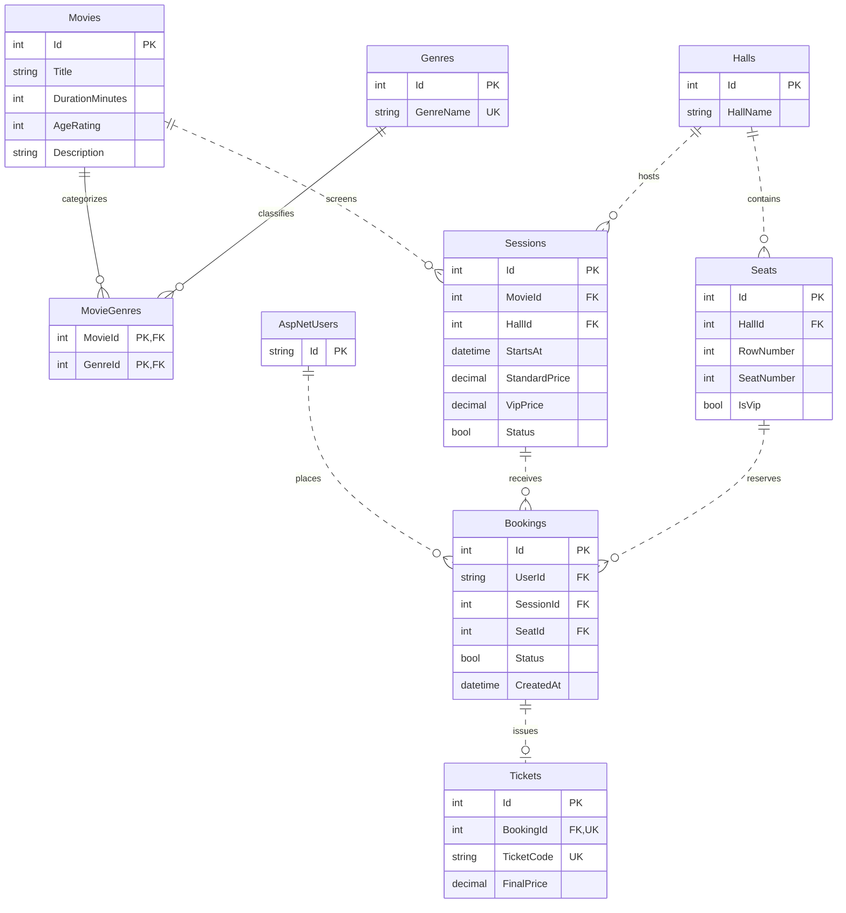
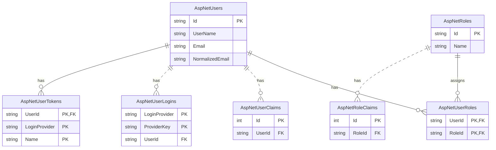

# CinemaGO Backend

CinemaGO is a cinema management and ticket booking API built with ASP.NET Core and C#. Customers can browse movies and showtimes, check seat availability, book a seat, and view their booking history. Cinema staff can manage the movie catalog, showtimes, halls, and seating.

## Features

| Role | What they can do |
| --- | --- |
| Customer | Register, sign in, check seat availability, book a seat, cancel their own bookings, and view booking history. |
| Admin | Manage movies, genres, sessions, halls, and seats, and review bookings. |
| SuperAdmin | Use admin features and grant or remove the Admin role. |

The API uses ASP.NET Core Identity for account and role management and JWT bearer tokens for authenticated requests. Public catalog endpoints let visitors browse movies and sessions before signing in.

## Tech stack

- C# and ASP.NET Core Web API (.NET 8)
- SQL Server and Entity Framework Core 8 with code-first migrations
- ASP.NET Core Identity and JWT bearer authentication
- AutoMapper and Swagger UI
- xUnit and Moq

## Project structure

| Layer | Responsibility |
| --- | --- |
| Domain | Entities, enums, DTOs, and repository interfaces |
| Application | Business rules, services, and mapping profiles |
| Infrastructure | EF Core context, repositories, migrations, and Identity seeding |
| Web (`Cinema.Web`) | API controllers, authentication setup, and Swagger |
| Tests | Service and repository tests |

## Database diagram

The diagrams show the key columns and relationships in the EF Core model. Both diagrams share the `AspNetUsers` table, which stores `ApplicationUser` accounts.

### Cinema and bookings



### ASP.NET Core Identity



| Database constraint | What it enforces |
| --- | --- |
| `MovieGenres(MovieId, GenreId)` composite primary key | A genre can be linked to the same movie only once. |
| Unique index on `Seats(HallId, RowNumber, SeatNumber)` | A row and seat number identify a single seat within a hall. |
| Unique index on `Bookings(SessionId, SeatId)` filtered by `[Status] = 1` | A seat can have at most one active booking for a given session. |
| Unique foreign key `Tickets.BookingId` | Each ticket belongs to one booking, and a booking can have at most one ticket. |
| Unique index on `AspNetUsers.NormalizedEmail` filtered by `[NormalizedEmail] IS NOT NULL` | A normalized email can be assigned to only one user. |

## Run locally

1. Install the .NET 8 SDK, SQL Server, and Visual Studio with the ASP.NET and web development workload.
2. Open the `CinemaManagementSystem` solution and set `Cinema.Web` as the startup project.
3. In Visual Studio, right-click `Cinema.Web` and select **Manage User Secrets**. Configure `ConnectionStrings:DefaultConnection` for your SQL Server instance. Use the JWT keys read by `Program.cs` for the issuer, audience, and signing key. If you use the admin seeders, add the credentials they read from configuration.
4. Open **Tools → NuGet Package Manager → Package Manager Console**. Select the Infrastructure project as the default project and apply the migrations:

   ```powershell
   Update-Database -StartupProject Cinema.Web
   ```

5. Run `Cinema.Web` and open Swagger at the launch URL for your active profile.
6. Sign in through the Auth endpoints. Use **Authorize** in Swagger to enter the returned JWT before calling protected endpoints.

## Booking rules

- Each booking reserves one seat, and the seat must belong to the hall where the session takes place.
- A filtered unique index on the session and seat IDs allows only one active booking for that seat in that session.
- Cancellation marks a booking inactive so the seat becomes available again.
- A booking generates one ticket with a unique code. The ticket price comes from the session's standard or VIP rate, based on the seat type.
- A movie must have at least one genre.
- A hall with sessions, a session with bookings, or a seat with bookings cannot be deleted.

## Explore the API

Use Swagger to find the current routes and request bodies. To try the customer flow, register and sign in, choose a movie session, check its available seats, and book one of them. Then open your booking history to verify the reservation and cancel it to release the seat.

## Run tests

From the solution directory, run:

```bash
dotnet test
```

The booking tests cover how active reservations affect seat availability and how the booking service handles an already reserved seat.
